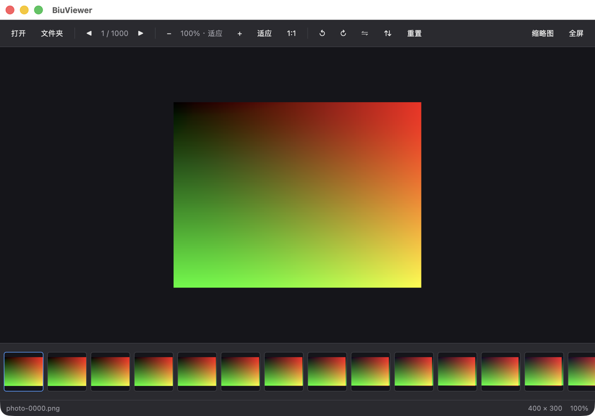

# 博览 BiuViewer

轻量、快速的跨平台图片浏览器，基于 Rust + GPUI 构建。打开即看，不做画库、不做编辑，专注把「看图片」这件事做快做好。

A lightweight, fast cross-platform image viewer written in Rust with GPUI. Open and view — no library management, no editing, just fast image viewing.



## 特性

- **快**：原生 GPU 渲染，缩略图与主图异步解码，翻页不等加载完成
- **省**：内存 LRU 缓存 + 纹理显式释放，连续翻页 500 张内存不持续增长
- **稳**：损坏 / 不支持 / 无权限的文件都有明确提示，不会崩溃
- **顺**：滚轮以光标为锚点缩放、拖拽平移、旋转翻转、全屏沉浸浏览
- **对**：按 EXIF Orientation 校正方向，手机竖拍照片不会躺倒
- **活**：GIF 按原始帧率循环播放

## 下载

前往 [Releases](https://github.com/tagecode/biu-viewer/releases) 下载最新版本：

| 平台 | 文件 | 说明 |
| :--- | :--- | :--- |
| macOS | `BiuViewer-vX.Y.Z-macOS-universal.zip` | 通用二进制，同时支持 Intel 与 Apple Silicon |
| Windows | `BiuViewer-vX.Y.Z-windows-x64.zip` | 64 位便携版，解压即用 |
| Linux | `BiuViewer-vX.Y.Z-linux-x86_64.tar.gz` | 64 位，附带 `install.sh` |

各平台安装与首次运行说明见 [docs/INSTALL.md](docs/INSTALL.md)。

## 快捷键

| 操作 | 快捷键 |
| :--- | :--- |
| 打开图片 | `⌘O` / `Ctrl+O` |
| 打开文件夹 | `⇧⌘O` / `Ctrl+Shift+O` |
| 上一张 / 下一张 | `←` / `→` |
| 第一张 / 最后一张 | `Home` / `End` |
| 放大 / 缩小 | `+` / `-`（带 `⌘`/`Ctrl` 亦可） |
| 适应窗口 | `0`（带 `⌘`/`Ctrl` 亦可） |
| 顺时针 / 逆时针旋转 | `R` / `⇧R` |
| 水平 / 垂直翻转 | `H` / `V` |
| 进入 / 退出全屏 | `F` 或 `F11` |
| 关闭提示条 / 退出全屏 | `Esc` |

鼠标：滚轮缩放（以光标位置为锚点），按住左键拖拽平移，点击工具栏「缩略图」开关底部缩略图条。

命令行：`biuviewer <图片或文件夹路径>`，也可把文件 / 文件夹直接拖入窗口。

## 支持格式

PNG、JPEG、GIF（含动画）、BMP、WebP、TIFF、ICO。

格式识别优先读取文件头魔数，扩展名只作为兜底，因此「PNG 改名成 .jpg」也能正确显示。

## 从源码构建

需要 Rust 1.93+ 与支持 Vulkan/Metal/DX12 的系统。

```bash
cargo build --release
./target/release/biuviewer
```

打包发布产物：

```bash
./scripts/bundle-macos.sh    # macOS .app + zip
./scripts/bundle-windows.sh  # Windows 便携 zip
./scripts/bundle-linux.sh    # Linux tar.gz
```

## 性能

基准数据与测试方法见 [docs/benchmark.md](docs/benchmark.md)：

```bash
./scripts/bench-manual.sh    # 生成素材 + 微基准 + 内存采样
```

## 已知问题与限制

- 当前版本**未做代码签名**：macOS 首次打开需右键「打开」或 `xattr -cr`，Windows 会触发 SmartScreen 提示
- Linux 仅提供 x86_64 构建，需要系统具备 Vulkan 或 OpenGL 驱动
- GIF 自动循环播放，暂不支持暂停 / 逐帧
- 暂不支持 HEIC、AVIF、RAW 等格式
- 暂无图片删除、重命名等文件管理功能

更多问题见 [docs/FAQ.md](docs/FAQ.md)。

## 项目结构

```
crates/
  biuviewer/           可执行程序：启动、窗口、命令行
  biuviewer-core/      领域模型：图片列表、视口数学、变换、缓存、错误
  biuviewer-decoder/   格式识别、解码、EXIF 校正、文件夹扫描
  biuviewer-ui/        GPUI 视图：主视图、工具栏、缩略图条、状态栏
  biuviewer-platform/  平台能力：系统文件对话框
```

依赖方向严格单向：`biuviewer → ui/platform/core`，`ui → core/decoder`，`platform → core`，`core` 不依赖工作区内其他 crate。
